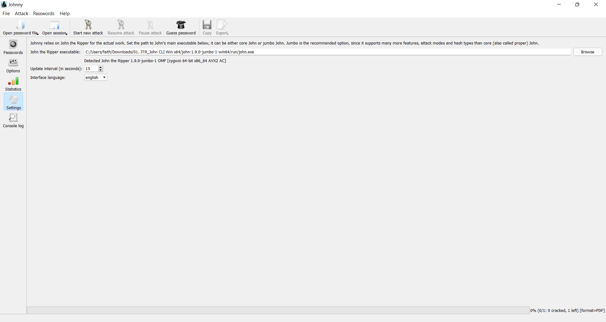

  
# PASSWORD CRACKING

*Password Cracking with John the Ripper and Networkwalks Tools.*

---

## 📌 Project Overview
This week's practical focused on password cracking using hashes, dictionaries, and wordlists to recover passwords for three protected PDF files from the Networkwalks internship lab. I used two methods — John the Ripper (JTR) and the Networkwalks Hash Calculator/Password Cracker — both of which successfully unlocked the files and revealed the flags. This was my first hands-on experience with password cracking, and it taught me a lot about troubleshooting and adapting wordlists when an approach didn't work.

## 🎯 Objectives
- Grasp the fundamentals of how password cracking works.
- Learn how to extract hashes from password-protected PDF files.
- Apply password-cracking tools to test candidate passwords against extracted hashes.
- Explore how dictionaries and wordlists support the cracking process.
- Build hands-on familiarity with John the Ripper/Johnny.
- Work through and resolve technical issues that came up during the exercise.
- Recover the passwords for all three authorized PDF files provided.
- Record the process and outcomes for inclusion in my cybersecurity portfolio.

## 🛠️ Tools and Purposes
| Tool / Resource | Purpose |
|---|---|
| John the Ripper (JTR) | Command-line password-cracking tool; recovers passwords from file hashes |
| Johnny | GUI front-end for John the Ripper, for point-and-click password attacks |
| Networkwalks Hash Calculator | Browser-based tool to extract the password hash from a protected PDF |
| Networkwalks Password Cracker | Browser-based tool to test password candidates against the extracted hash |
| Password dictionaries / wordlists | Provide password candidates for testing |
| Windows 11 | Host OS/environment used to run both the local and browser-based tools |

  
## 🔍 Part 1 - Password Cracking with JTR (Johnny the Ripper)

### Task
Crack the password of the supplied PDF file (My Locked PDF1.pdf) using John the Ripper and the Johnny GUI on a Windows PC.

### Installation
- Downloaded John the Ripper from the official site — obtained the JTR binaries for Windows
- Downloaded the Johnny GUI from the official site — installer obtained
- Ran the Johnny setup file, which installed successfully
- Opened Johnny → Settings → Browse to point it to `john.exe`
- Located `john.exe` in the run folder of the JTR download, linking Johnny to the John the Ripper engine

### Hash Extraction
- Downloaded the encrypted file My Locked PDF1.pdf and saved it locally
- Uploaded the PDF to an online hash extractor (onlinehashcrack.com PDF hash tool), generating a hash value prefixed with `$pdf$...`
- Copied the hash value and verified no stray characters (e.g. a leading `b'`) were included
- Pasted the hash into Notepad and saved it as `hash1.txt`, ready for use with JTR

### Cracking the Password
- Opened Johnny, launching the GUI
- Clicked "Open password file" and selected `hash1.txt`, loading the hash into Johnny
- Clicked "Start new attack" to begin testing candidate passwords
- Waited for the attack to complete — the password was successfully cracked
- Opened My Locked PDF1.pdf and entered the recovered password, unlocking the PDF successfully

### Observation
John the Ripper recovered the PDF password within a few minutes using the default wordlist attack mode. This demonstrates that a weak or dictionary-based password can be recovered quickly by an attacker with access to the file's hash, reinforcing the need for long, non-dictionary passwords on sensitive documents.

#### Evidence:

