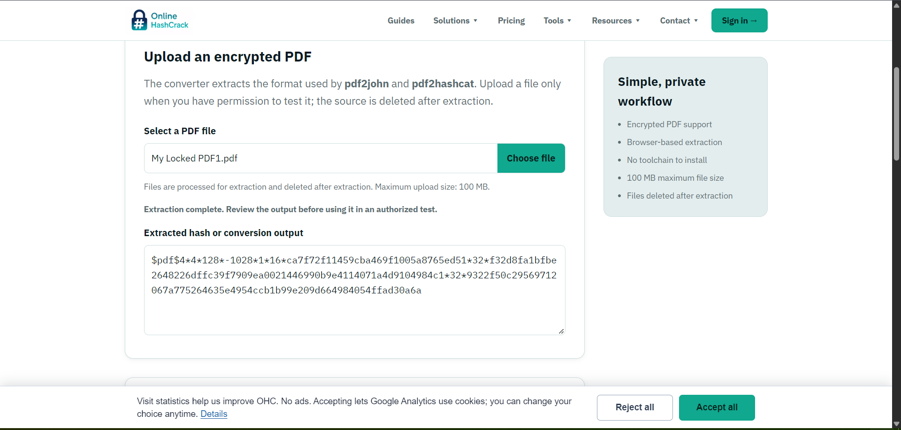
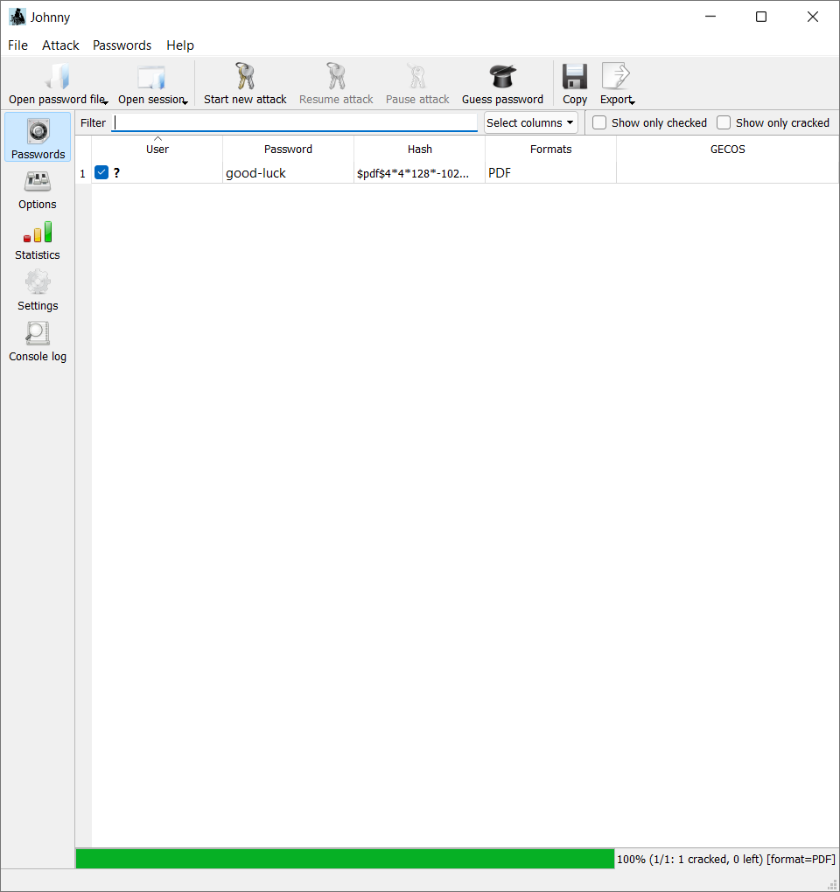
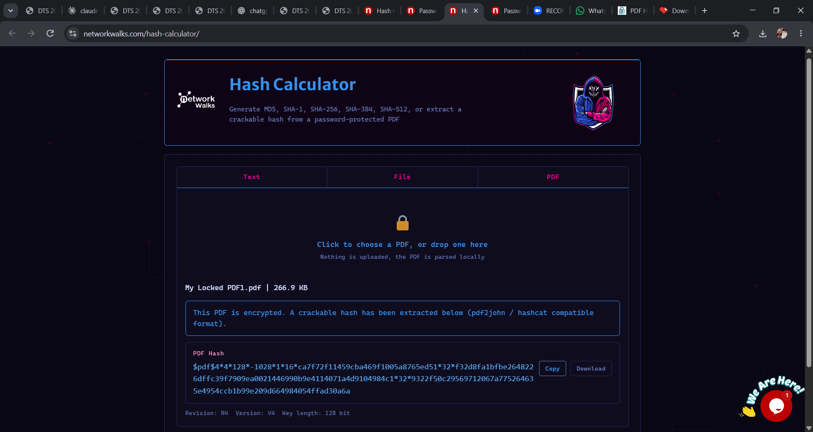
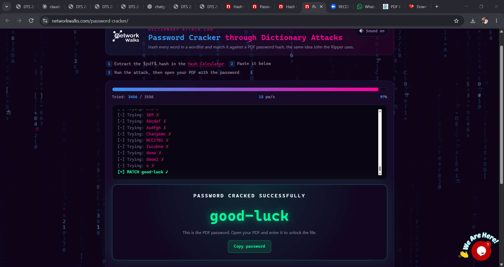
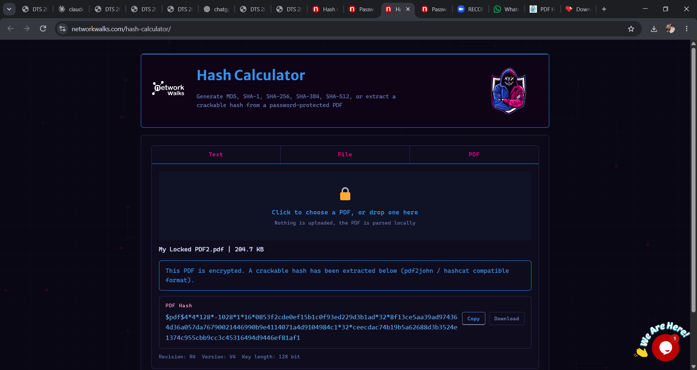
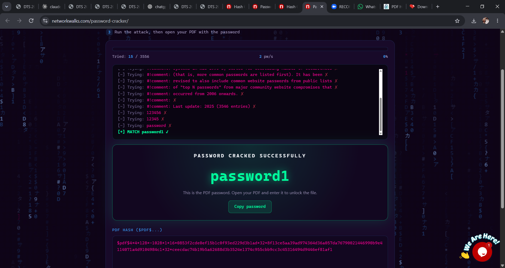
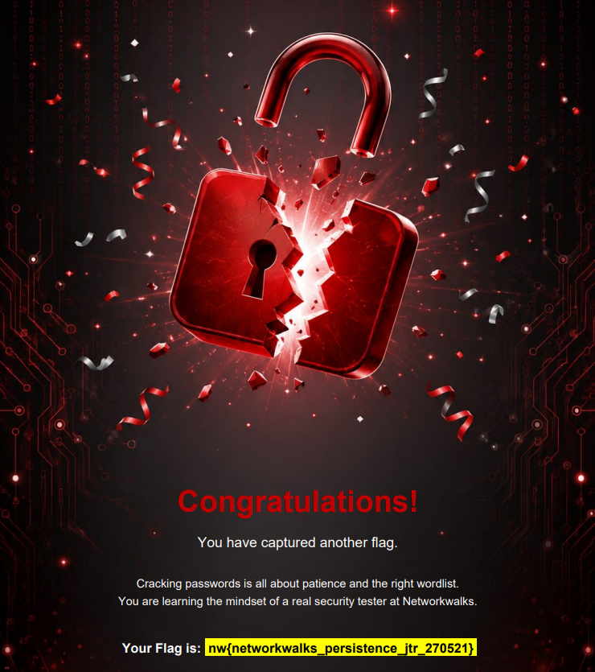
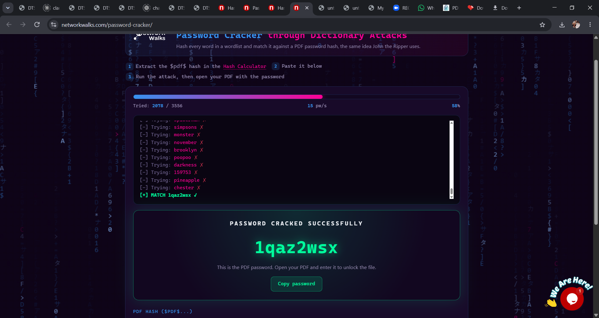
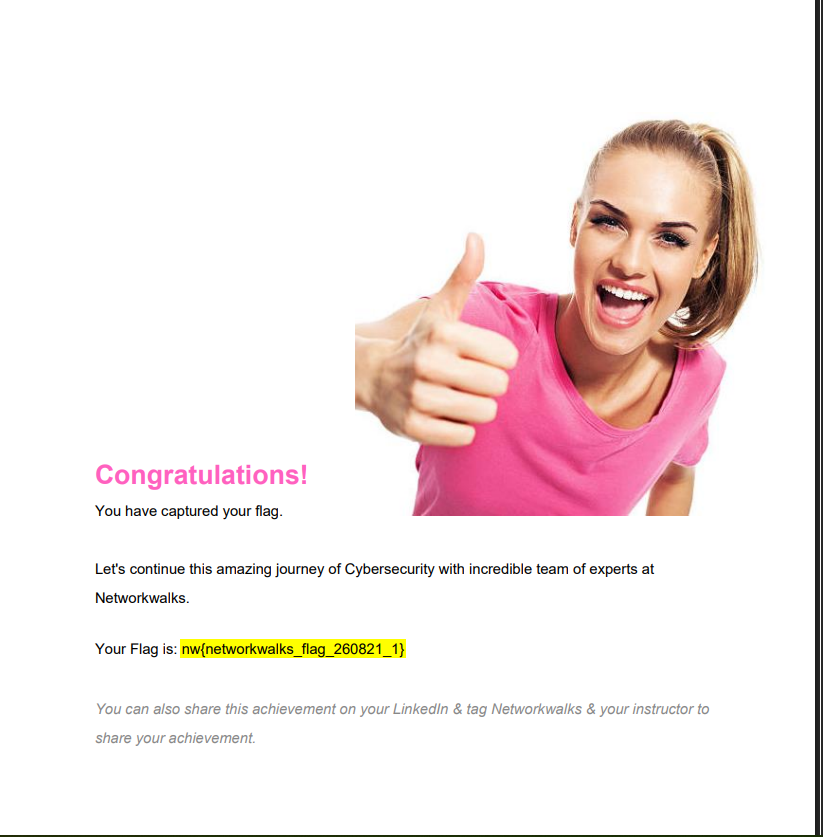

  
# PASSWORD CRACKING

*Password Cracking with John the Ripper and Networkwalks Tools.*

---

## 📌 Project Overview
This week's practical focused on password cracking using hashes, dictionaries, and wordlists to recover passwords for three protected PDF files from the Networkwalks internship lab. I used two methods — John the Ripper (JTR) and the Networkwalks Hash Calculator/Password Cracker — both of which successfully unlocked the files and revealed the flags. This was my first hands-on experience with password cracking, and it taught me a lot about troubleshooting and adapting wordlists when an approach didn't work.

## 🎯 Objectives
- Grasp the fundamentals of how password cracking works.
- Learn how to extract hashes from password-protected PDF files.
- Apply password-cracking tools to test candidate passwords against extracted hashes.
- Explore how dictionaries and wordlists support the cracking process.
- Build hands-on familiarity with John the Ripper/Johnny.
- Work through and resolve technical issues that came up during the exercise.
- Recover the passwords for all three authorized PDF files provided.
- Record the process and outcomes for inclusion in my cybersecurity portfolio.

## 🛠️ Tools and Purposes
| Tool / Resource | Purpose |
|---|---|
| John the Ripper (JTR) | Command-line password-cracking tool; recovers passwords from file hashes |
| Johnny | GUI front-end for John the Ripper, for point-and-click password attacks |
| Networkwalks Hash Calculator | Browser-based tool to extract the password hash from a protected PDF |
| Networkwalks Password Cracker | Browser-based tool to test password candidates against the extracted hash |
| Password dictionaries / wordlists | Provide password candidates for testing |
| Windows 11 | Host OS/environment used to run both the local and browser-based tools |

  
## 🔍 Part 1 - Password Cracking with JTR (Johnny the Ripper)

### Task
Crack the password of the supplied PDF file (My Locked PDF1.pdf) using John the Ripper and the Johnny GUI on a Windows PC.

### Installation
- Downloaded John the Ripper from the official site — obtained the JTR binaries for Windows
- Downloaded the Johnny GUI from the official site — installer obtained
- Ran the Johnny setup file, which installed successfully
- Opened Johnny → Settings → Browse to point it to `john.exe`
- Located `john.exe` in the run folder of the JTR download, linking Johnny to the John the Ripper engine

### Hash Extraction
- Downloaded the encrypted file My Locked PDF1.pdf and saved it locally
- Uploaded the PDF to an online hash extractor (onlinehashcrack.com PDF hash tool), generating a hash value prefixed with `$pdf$...`
- Copied the hash value and verified no stray characters (e.g. a leading `b'`) were included
- Pasted the hash into Notepad and saved it as `hash1.txt`, ready for use with JTR

### Cracking the Password
- Opened Johnny, launching the GUI
- Clicked "Open password file" and selected `hash1.txt`, loading the hash into Johnny
- Clicked "Start new attack" to begin testing candidate passwords
- Waited for the attack to complete — the password was successfully cracked
- Opened My Locked PDF1.pdf and entered the recovered password, unlocking the PDF successfully

### Observation
John the Ripper recovered the PDF password within a few minutes using the default wordlist attack mode. This demonstrates that a weak or dictionary-based password can be recovered quickly by an attacker with access to the file's hash, reinforcing the need for long, non-dictionary passwords on sensitive documents.

#### Evidence:

## 🔍 Part 2 — Password Cracking with Networkwalks Tools

### Task
Crack the passwords of the three protected PDF files (including My Locked PDF1.pdf) using the Networkwalks Hash Calculator and Networkwalks Password Cracker — both free, browser-based tools requiring no installation.

### Steps
- Downloaded the encrypted PDF files from the lab page on networkwalks.com
- Opened the Networkwalks Hash Calculator (networkwalks.com/hash-calculator)
- Uploaded each locked PDF file, and the tool extracted the corresponding hash for each, prefixed `$pdf$...`
- Copied each complete hash value, confirming the full string was captured starting from `$pdf$`
- Opened the Networkwalks Password Cracker (networkwalks.com/password-cracker)
- Pasted the first hash and started the attack using the built-in dictionary of about 100 common words
- The attack completed, but the password was not recovered — the initial wordlist wasn't large enough
- Went back through the internship resources and found a larger wordlist associated with JTR default/common passwords
- Uploaded the larger wordlist and reran the attack
- This time, the attack succeeded and the cracked password was displayed on screen
- Repeated the same process — extracting the hash and running the attack with the larger wordlist — for the remaining two PDFs
- All three passwords were successfully recovered
- Opened each PDF and entered its corresponding cracked password, unlocking all three files successfully

### Observation
The Networkwalks online tools successfully recovered the passwords for all three PDF files, without requiring any software installation. The first attempt on PDF 1 with the smaller built-in dictionary failed, showing that having a cracking tool alone isn't enough — wordlist size and quality play a major role in whether an attack succeeds. Once a larger wordlist was used, all three passwords were recovered without further issues. This also highlights that password cracking is accessible even without specialist local tooling, since browser-based cracking services lower the barrier further, meaning weak document passwords can be broken by almost anyone with internet access.

#### Evidence:

## 💡 What I Learned

### 1. A hash is not the same as a password
Protected PDFs don't store the password itself — they store a hashed version of it. Cracking works by testing candidate passwords, hashing each one, and checking if it matches the stored hash. If it does, that's the password; if not, the tool moves to the next guess. This also showed me why hashing is a one-way process — there's no shortcut to reverse a hash back into a password.

### 2. The wordlist makes all the difference
My first attempt used a small built-in dictionary of about 100 common passwords, and it failed completely — the first pdf especially. It was only after finding a larger wordlist of common/default passwords that it was recovered. The tool stayed the same throughout; only the wordlist changed. That made it clear that a cracking tool is only as effective as the data fed into it.

### 3. Real-world cybersecurity demands flexibility
The task looked simple on paper, but my first cracking attempt on the Networkwalks side failed outright due to a weak wordlist, meaning I had to go back and find a better one before tr

## 📝 Conclusion 

This week's practical gave me my first hands-on experience with password cracking, working through hash extraction and wordlist-based attacks to recover all three PDF passwords. Using both John the Ripper/Johnny and the Networkwalks tools showed that the right wordlist matters more than the tool itself. It also reminded me that troubleshooting and adapting are just as much a part of cybersecurity as the technical steps, and gave me a clearer picture of why weak passwords remain such a common risk.

## ⚠️ Disclaimer

This practical was carried out strictly within the scope of the Networkwalks Cybersecurity Internship, using only the files and tools provided for this authorized training exercise. All password-cracking activity documented here was performed on files supplied specifically for this lab, and was not carried out against any unauthorized systems or data.

## 👧 Author
**Owoseni Fiyinfoluwa Faithfulness**

Cybersecurity Intern at Network Walks

## 📌 Project Information 

**Project:** Password Cracking with Johnny the ripper and Networkwalks tools|
**Week:** 03|
**Program Name:** Cybersecurity at Networkwalks|
**Repository:** Github
